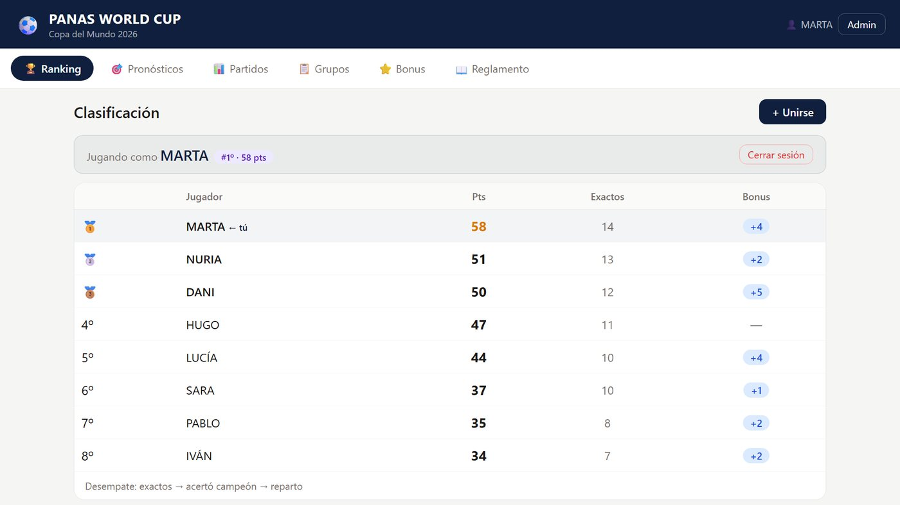
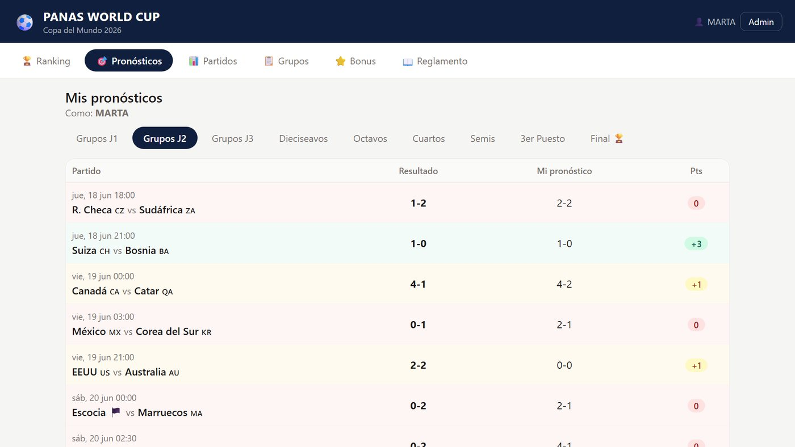
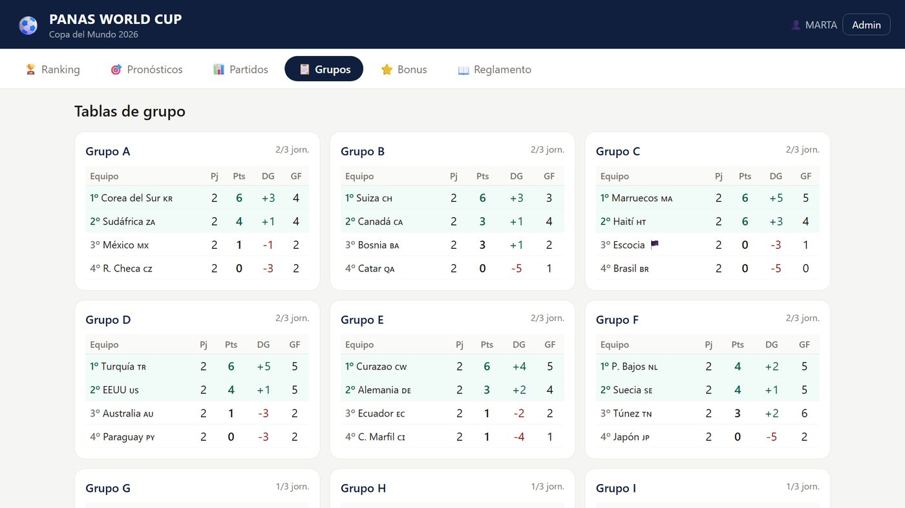

# Panas World Cup 2026 ⚽

Quiniela del Mundial 2026 para un grupo de amigos. Cada jugador pronostica el marcador de los 104 partidos del torneo, además del campeón, el subcampeón y el máximo goleador, y una clasificación que se actualiza sola reparte los puntos a medida que el administrador introduce los resultados.

Hecha con React, Vite y Supabase, y desplegada en Vercel.



> Las capturas son de una copia con datos de ejemplo: los jugadores son inventados.

## Qué hace

- **Jugadores:** registro e inicio de sesión con nombre y contraseña.
- **Pronósticos:** el marcador de los 104 partidos (72 de la fase de grupos y 32 eliminatorios). Cada pronóstico se bloquea solo cuando empieza el partido, y los bonus, al comenzar el torneo.
- **Puntuación automática:** 3 puntos por el resultado exacto y 1 por acertar el ganador o el empate. En la fase de grupos, los partidos del grupo de España valen el doble; en las eliminatorias, solo los de España.
- **Eliminatorias con penaltis:** si un partido acaba en empate, también se pronostica quién gana la tanda, con puntos propios por acertar el empate, el ganador de los penaltis o ambos.
- **Bonus:** campeón (+10), subcampeón (+5) y máximo goleador (+5), más una «peor selección» asignada a cada jugador que le da +1 punto por cada gol que marca y +1 por cada 3 que recibe.
- **Tablas de grupo y cuadro:** se calculan a partir de los resultados, incluida la elección de los 8 mejores terceros, y los cruces eliminatorios se rellenan solos.
- **Modo administrador:** introduce los resultados (con el ganador de los penaltis si hace falta), asigna los puntos de los bonus y puede dar de baja a un jugador.
- **Siempre al día:** los datos se vuelven a cargar cada 30 segundos.

| Pronósticos | Tablas de grupo |
| --- | --- |
|  |  |

## Cómo está hecha

- **React 18 y Vite**, sin librerías de interfaz: los estilos están escritos a mano en `src/styles.css` y la navegación entre vistas (ranking, pronósticos, partidos, grupos, bonus y reglamento) es estado de React, sin router.
- **Supabase (PostgreSQL)** guarda usuarios, resultados, pronósticos y bonus. `src/db.js` reúne todas las operaciones y la app lo lee todo de una vez con `loadAll()`.
- **Las reglas viven en funciones puras**: `src/scoring.js` calcula los puntos de cada partido y `src/bracket.js` construye las tablas de grupo (por puntos, diferencia de goles y goles a favor), elige los mejores terceros y resuelve etiquetas como `1ºA` o `G P73` («ganador del partido 73») para completar el cuadro.
- **Todos los partidos están en `src/matches.js`**, con sus horas en horario de Madrid.

## Ejecutarla en local

1. Crea un proyecto gratuito en [Supabase](https://supabase.com) y ejecuta `supabase_schema.sql` en el *SQL Editor*.
2. Copia `.env.example` como `.env.local` y rellénalo con la URL del proyecto y la clave `anon` (*Settings → API*).
3. Instala y arranca:

```bash
npm install
npm run dev
```

## Desplegarla

Importa el repositorio en [Vercel](https://vercel.com) y añade como variables de entorno `VITE_SUPABASE_URL` y `VITE_SUPABASE_ANON_KEY`. Cada `git push` a `main` la actualiza.

## Estructura

```
panas-wc/
├── src/
│   ├── main.jsx          # Entrada de React
│   ├── App.jsx           # Componente principal y vistas
│   ├── matches.js        # Los 104 partidos del Mundial
│   ├── bracket.js        # Tablas de grupo y cuadro eliminatorio
│   ├── scoring.js        # Cálculo de puntos
│   ├── db.js             # Operaciones con Supabase
│   ├── supabase.js       # Cliente de Supabase
│   └── styles.css        # Estilos
├── docs/                 # Capturas del README
├── supabase_schema.sql   # Esquema de la base de datos
├── index.html
├── vite.config.js
└── package.json
```

## Limitaciones

La seguridad es deliberadamente ligera, pensada para un grupo de amigos de confianza: las contraseñas se comparan en el cliente con un hash sencillo, el modo administrador se protege con una contraseña que vive en el código y las políticas de Supabase permiten leer y escribir con la clave pública. Para abrirla a desconocidos habría que pasar a Supabase Auth con políticas por usuario.
